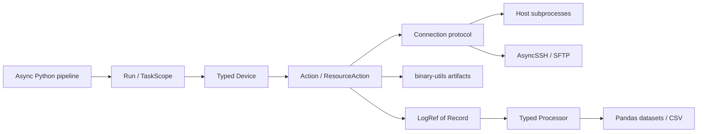

# Interfaces and ownership

The public package uses immutable dataclass configuration, typed identities,
structural protocols, and Python 3.14 generics. There is no YAML frontend or
string-keyed device routing.

## Connection

`ConnectionBackend.connect()` opens a connection through an async context manager.
Connections expose a backend-derived string device identity, a private `tmp_dir`, target
metadata, device-bound paths, command execution, managed launch, file reads/writes,
transfers, glob discovery, and executable lookup. Existing sessions are confined to one
event loop. Several connections to the same device share `DeviceId`; they can use the
same target paths and process selections. Workspaces, process ownership, and deployment
destinations remain separate. Resource claims protect the same device/path across
connections. Run output directories use connection counters rather than raw device
strings.

Each backend initializes its workspace before yielding the connection and owns
its cleanup, including when used without Run. Host workspaces have private
permissions and names `/tmp/vsm-tmp-data-<UTC-date>-<unique-suffix>`. Binaries,
SSH job controls, and Rup markers use these workspaces. Cleanup uncertainty
retains recovery files. Native and supplied binary deployment lives in
`vsm.binary` and uses only the connection protocol. Run supplies a lazy default
BinaryProvider using the imported checkout’s artifact bundle. Per-tool variants
are selected by execution requirements independently of transport; see
[native builds](native-builds.md).

`Exec` preserves literal argv; `Shell` explicitly enables shell evaluation. Environment
overlays are tuples of `EnvVar`. Outputs are a union of `CaptureOutput`, `FileOutput`,
and `DiscardOutput`, never mode dictionaries. Host and SSH use a target-local
`targetctl` supervisor for public launches. Each supervisor pins workload identity
before exec and owns a separate process group. A renewable control lease and channel EOF
initiate group cleanup on loss. Private transport bootstrap commands deploy/validate the
helper without recursively calling supervised launch. SSH retains verified host keys and
SFTP; process supervision is implemented by targetctl. Workload argv, environment, and
cwd travel as protocol data. `Process.identity()` and `processes()` select the owned
workload; `Capture.processes()` delegates to its attached handle. Closing a transport
alone does not confirm cleanup. See [targetctl](targetctl.md) for the protocol, timing
defaults, extension contract, and recovery behavior.

Host and SSH glob discovery return an empty tuple when nothing matches. SSH maps
SFTP missing-file/path outcomes to that result; permission and transport failures
still propagate.

`Connection.run()` accepts a command plus `check`, `stdout`, and `stderr` options.
Callers set operation deadlines with `asyncio.timeout()` around the call or a
larger workflow. The deadline covers launch entry and command execution; scoped
cleanup is joined before the deadline error returns, so elapsed time can exceed
the requested deadline. Cancelling only a process/capture waiter does not terminate
the workload. Native durations, probe reply timeouts, private bootstrap deadlines,
and startup/cleanup/lease safeguards have separate roles and remain available.

Transfers initially operate on regular files and reject existing destinations.
Byte reads have a 16 MiB limit; use file transfer for larger data. Streamed output
is persisted directly to host files. Process-group management cannot contain
processes that deliberately create independent sessions, and permanent target
loss cannot guarantee restoration. Such outcomes are recorded as failures or
unknown cleanup, with recovery directories retained.

## Actions and resources

An `Action[T]` has `async run(ctx) -> T`; a `ResourceAction[T]` has
`open(ctx) -> AsyncContextManager[T]`. Configuration is separate from invocation
state. Factories can be ordinary constructors; no framework inheritance is
required. Context exposes a connection, unique output paths, native binary
resolution/deployment, typed services, and supervised workers.

`Device.do()` returns finite results. `Device.use()` scopes collectors and
settings. Before returning from resource entry, collectors establish readiness.
Every action invocation receives its own identity and directory. Settings
register device/path conflict claims within a run and restore previous values even after
partial startup or cancellation. Claims protect all equal-device connections within one run;
external programs and independently created runs require coordination outside
this in-memory mechanism.

Built-in launch-like actions support both entrypoints without a launch mode.
`do()` waits for natural completion and finalization, returning a log or completed
command. `use()` establishes readiness and yields the owned handle; scope exit
stops/reaps remaining work and finalizes the capture. Natural completion inside
a scope requires an explicit `await capture.wait()` or `await process.wait()`
when the caller wants to await it before exit. Successful completion is also
allowed before the caller starts waiting, including during startup when the
required readiness evidence is present; nonzero exits remain supervised failures.

Natural waits run as ordinary cancellable action/body work, outside cleanup
shielding. Resource exit remains cancellation resistant, including for direct
`action.open(ctx)` callers. The runtime uses the ordinary resource lifecycle
without a built-in launch-scope special case. Claims also apply to `do()` actions
such as Ftrace. Cancelling an individual waiter does not stop its workload;
exiting its owning scope does. `run.spawn(device.do(action))` supplies supervised
concurrent execution, and run exit joins or cancels these tasks under the existing
structured-concurrency rules. Open-ended actions need a completion condition or
caller cancellation when invoked through `do()`.

Process discovery returns `ProcessSet`, an immutable `Sequence[ProcessIdentity]`
with device, boot, PID, and start-tick identity per element. Its positional
iterable constructor snapshots inputs, preserving order and duplicates. Length,
iteration, membership, and indexing act directly on the selection; slices return
`ProcessSet`. The backing tuple is private; there is no `.processes` field or
`processes=` constructor keyword.

`PidStat`, `ProcessIo`, and `Smaps` all accept `processes=selection`. Shared
startup validation rejects empty selections, foreign devices, known boot
mismatches, and PID reuse; target read errors propagate. Equal-device
connections may use the same selection. Native pspider and process-aware rfpoll
also pin procfs directory descriptors and validate identities while sampling.
Confirmed process/thread termination emits a lifecycle event and ends its series;
collectors never follow replacements for explicitly selected PIDs. Unexpected
read failures remain errors. Smaps rows also retain process start
identity rather than grouping solely by path. Artifacts are direct typed results instead of
`${name}` references.

Identity string formatting returns the stored value while preserving distinct
types and equality. `TargetPath` supports string formatting, name/parent access,
and POSIX joining with strings or `PurePosixPath`. Parent and joined paths retain
device identity, including when an absolute operand replaces the path. Joining
two target paths is rejected; target paths do not implement `__fspath__` for
controller-local I/O. Explicit `.value` remains available on scalar wrappers.

## Scheduling and shutdown

`Run.spawn(coroutine)` returns `TaskHandle[T]`. Await the handle or its `join()`
for T. `cancel_and_wait()` requests cancellation and joins cleanup. TaskScope
provides the same API without experiment directories. TaskGroup owns children,
joins finite work on normal exit, and cancels siblings after unhandled failure.
Dropping a handle does not detach work.

Collectors own internal workers through context supervision. They stop before
scope exit joins those workers. Waiting for process completion alone does not
kill a process when the waiter is cancelled; the enclosing launch scope owns
termination. Output-drain errors also stop owned work. Cleanup retains its task
through repeated cancellation. Primary failures retain cleanup notes and the
run manifest records cleanup errors; it never converts failures to empty success.

Scoped native collectors, rgen and framework rup default to no duration limit.
`duration=None` omits the native deadline (or framework rup timer); scope exit
stops owned work. Explicit finite durations and completion counts remain available
for callers waiting for natural completion. Manual examples impose no deadline.

An explicitly timed file/process/socket collector may complete successfully while
its resource scope stays open. Readiness must still be observed, including when
the tool completes before Python sees its readiness record. Nonzero exits fail;
unexpected completion of an open-ended collector fails. Waiting does not finalize
the capture: resource exit owns finalization and clean-end validation.

## Processing and extensions

`LogRef[Record]` identifies a finalized file, schema, device/action, completion
status, and target metadata. CPU and network logs have distinct record types.
Processors implement `process(LogRef[Record], params=Params) -> Result`; CPU logs
are rejected statically by network processors and schemas are validated at
runtime. Native JSONL and external tool formats are separate input contracts.

The async processing wrapper runs synchronous parsing in a worker thread and
joins the worker on cancellation. This avoids blocking I/O on the event loop;
it does not promise CPU parallelism or hard cancellation of pandas. Large
analyses may require a future process-worker API. Datasets contain dataframes,
labels, column/unit descriptors, warnings, and declarative chart descriptions.
`LogMetadata.clock` carries typed controller UTC/target monotonic calibration
samples and uncertainty; `time_origin` identifies the measurement clock origin.
Host/SSH connections own bounded calibration workers and expose typed
`sample_clock()`/`calibrate_clock()` methods. Capture finalization checkpoints
calibration and writes raw-log metadata companions. Processing adds integer UTC
timestamps without changing elapsed-rate arithmetic. Missing mappings retain
elapsed axes with warnings; see [chart reports](chart-reports.md#controller-utc-timelines).

Rendering is separate: `vsm.chart` provides line/box/bar/table descriptions and a
custom chart protocol with Plotly and Matplotlib figure methods. Each processor
chooses charts and units explicitly. `vsm.output.charts` generates collapsible or
table HTML reports and separate files. Static reports embed PNGs; interactive
reports embed Plotly.js once. Direct figures support notebooks and IDEs.
`Dataset.to_csv` writes ordinary CSV plus a `<filename>.json` sidecar containing
dataset metadata, typed cell descriptions and allowlisted built-in chart definitions.
`Dataset.from_csv` restores these for independent rendering, without target access
or original raw logs. Keep both files together; only the current release's format
is supported. CSV serialization lives in focused private modules, separate from
measurement processing and report composition. Entity-bearing datasets also include
a readable `entity_label` CSV column. Display labels never replace grouping
identities. Data without chart descriptions is rendered as an escaped table. Reports use content-driven
legends, responsive plot containers and source details; see
[chart reports](chart-reports.md).

`Services.register(Interface, implementation)` and `ctx.service(Interface)`
provide typed extension services. Explicit Registry names provide discovery
metadata and reject duplicates; ordinary direct imports need no registry.
Connection extensions implement the protocol and target Linux command/file
semantics. Future platform/transport profiles must define their workspace and
process ownership behavior before being advertised as supported.

## Modules and identity allocation

Package initializers contain no reexports. Import implementations from their
modules; runtime code never imports measurement registries. Measurement record
markers and network configuration live under `vsm.util`, alongside Rup format
validation. Compose dedicated actions with ordinary async Python.

Device IDs are strings provided by backends. Action IDs use run-wide counters;
process handles expose target PIDs without a generated UUID. Standalone log
imports accept explicit identities and otherwise record `unknown`/`imported`.
`run.json` includes `vsm_version` from installed package metadata derived from
`pyproject.toml`, with no format revision tag. APIs and stored formats follow the
rolling release policy.

Public connect/open/launch/use methods are ordinary methods with explicit async
context-manager return types; private generators implement their lifecycle.
Collectors own their lifecycle explicitly, with only small readiness, log, and
cancellation helpers shared between them.
